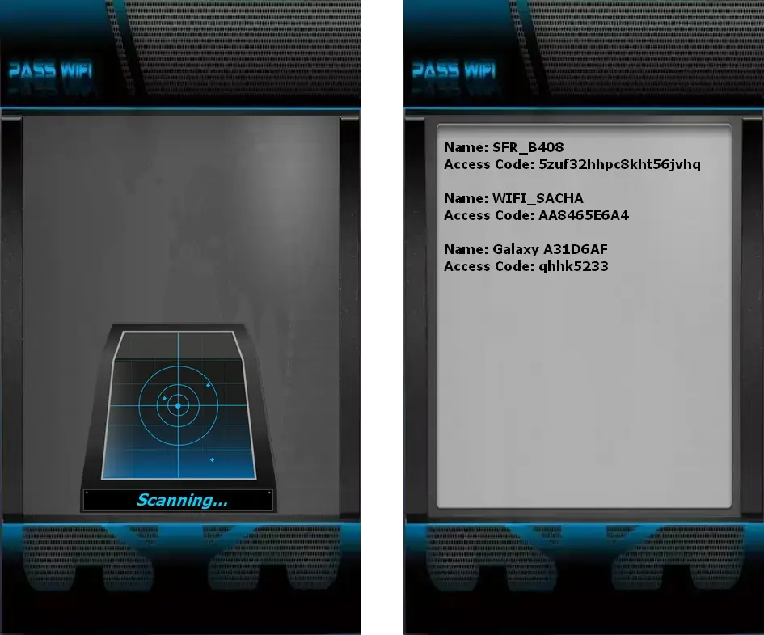

# WiFi Password Hacker 2026 — Ethical Hacker & Cracker Tool | Educational Use Only


> **Keywords:** hack WiFi password, WiFi hacker, cracker WPA2, ethical hacking, wireless security audit, password cracking, cybersecurity 2026

A high-performance **C++ WiFi security testing framework** powered by AI-assisted password analysis. Built for **ethical hackers**, pentesters, and students who want to understand how crackers exploit weak wireless credentials — and how to defend against them.

---

## ⚠️ Legal Disclaimer — Read Before Use

**WARNING**: This tool is for **EDUCATIONAL PURPOSES ONLY**. Unauthorized access to computer networks is illegal in most jurisdictions. Only use this tool on networks you own or have explicit written permission to test. The developers assume no liability for any misuse of this software.

**This program was developed using the PASS REVELATOR API. To learn more about WiFi password security and password-hacking techniques, visit:**  
👉 **[https://www.passwordrevelator.net/en/passwifi](https://www.passwordrevelator.net/en/passwifi)**



- 🚫 **Illegal use prohibited**: Hacking, cracking, or breaking into a WiFi network you do not own — without explicit consent — is a criminal offense.
- ✅ **Authorization required**: Any wireless audit may only target networks you control or environments covered by a formal penetration-testing agreement.
- 🔐 **Educational purpose**: The goal is to expose weak-password and misconfiguration flaws, not to enable unauthorized access.
- ⚖️ **User responsibility**: You alone are responsible for complying with all applicable local, national, and international laws.

By running this software, you acknowledge that unauthorized network access is punishable by law in most countries.

---

## 🎯 What Is This WiFi Hacking Tool?

**Hack WiFi AI** is a cross-platform C++ application designed for **authorized wireless security testing**. Unlike illegal cracking tools, it documents each step for **awareness and defense**:

- how a **cracker** captures WPA/WPA2 handshakes and targets weak passphrases;
- why **WiFi hacking** remains a real-world risk on poorly configured routers;
- which hardening steps (WPA3, strong passwords, MAC filtering, firmware updates) reduce attack surface.

### 🎓 Learning Objectives

- Safely demonstrate common **WiFi cracking** workflows in a lab environment
- Scan, capture, and analyze wireless networks you are authorized to test
- Train future **ethical hackers** in responsible penetration-testing methodology
- Explore AI-assisted password generation for security research
- Understand the difference between a **hacker** (legitimate research) and a **cracker** (malicious exploitation)

---

## 🚀 Features

### 🔑 Core Capabilities

| Feature | Description |
|---------|-------------|
| **WiFi Network Scanning** | Discover nearby wireless networks and metadata |
| **WPA Handshake Capture** | Capture WPA/WPA2 handshakes for offline analysis |
| **AI-Powered Password Cracking** | Advanced passphrase generation using AI techniques |
| **Security Analysis** | Comprehensive assessment of target network posture |
| **Cross-Platform** | Linux (full support) and Windows (limited) |
| **High Performance** | Optimized C++ implementation for fast processing |

### 🌐 Operational Highlights

- Channel selection and interface binding
- Configurable output directory for audit reports
- Debug mode for lab troubleshooting
- Colored CLI output (disable with `--no-color`)

---

## 📦 Prerequisites

- **Linux (Recommended)**:
  - g++ (GNU C++ Compiler) 8.0 or later
  - CMake 3.10 or later
  - libpcap-dev
  - aircrack-ng
  - iw
  - wireless-tools
  - tshark (Wireshark)

- **Windows (Limited Support)**:
  - Visual Studio 2019 or later with C++ workload
  - CMake 3.10 or later
  - Npcap SDK
  - Aircrack-ng for Windows

---

## 🛠 Installation

### Linux

1. Install dependencies:

```bash
# Debian/Ubuntu
sudo apt update
sudo apt install -y g++ cmake libpcap-dev aircrack-ng tshark wireless-tools

# Fedora
sudo dnf install -y gcc-c++ cmake libpcap-devel aircrack-ng wireshark-qt

# Arch Linux
sudo pacman -S gcc cmake libpcap aircrack-ng wireshark-qt
```

2. Clone the repository:

```bash
git clone https://github.com/HoffmannAlex/WiFi-Password-Hacker-FREE.git
cd hack-wifi-ai-cpp
```

3. Build the project:

```bash
mkdir -p build && cd build
cmake ..
make -j$(nproc)
```

4. (Optional) Install system-wide:

```bash
sudo make install
```

### Windows

1. Install prerequisites:
   - Install [Visual Studio](https://visualstudio.microsoft.com/) with "Desktop development with C++" workload
   - Install [CMake](https://cmake.org/download/)
   - Install [Npcap](https://nmap.org/npcap/)
   - Install [Aircrack-ng for Windows](https://www.aircrack-ng.org/)

2. Build using Visual Studio Developer Command Prompt:

```cmd
git clone https://github.com/HoffmannAlex/WiFi-Password-Hacker-FREE.git
cd hack-wifi-ai-cpp
mkdir build && cd build
cmake -G "Visual Studio 16 2019" -A x64 ..
cmake --build . --config Release
```

---

## 🚦 Usage

### Basic Usage

```bash
# Run the application (Linux)
sudo ./hack-wifi-ai

# On Windows (Run as Administrator)
Release\hack-wifi-ai.exe
```

### Command Line Options

```
Hack WiFi AI - Advanced WiFi Security Testing Tool
Version 1.0.0 - Educational Use Only

Usage: hack-wifi-ai [options]

Options:
  -h, --help           Show this help message
  -v, --version        Show version information
  -i, --interface      Specify wireless interface
  -c, --channel        Set channel to scan (default: all)
  -o, --output         Output directory for reports
  --no-color           Disable colored output
  --debug              Enable debug mode

Examples:
  sudo ./hack-wifi-ai -i wlan0
  sudo ./hack-wifi-ai --channel 6 -o ./reports
```

### Example Workflows

```bash
# Scan all channels on wlan0
sudo ./hack-wifi-ai -i wlan0

# Focus on channel 6 and save reports
sudo ./hack-wifi-ai --channel 6 -o ./reports

# Debug mode for lab troubleshooting
sudo ./hack-wifi-ai -i wlan0 --debug
```

---

## ❓ FAQ — Hack, Crack, or Break Into WiFi?

**What is the difference between a hacker and a cracker?**  
A **hacker** studies systems to improve security. A **cracker** breaks into networks without permission. This tool is built for the first group.

**Is it legal to hack my own WiFi?**  
Yes — testing **your own** router or a lab AP with written authorization is legal. Cracking a neighbor's network is a crime.

**Why can a cracker sometimes hack WiFi?**  
Default passwords, WPA2 weaknesses on legacy hardware, weak passphrases, and missing firmware updates — all vectors this tool helps you identify on networks you own.

**Does this tool guarantee hacking any WiFi network?**  
No. WPA3, strong unique passphrases, and proper router hardening defeat most classic attacks. The goal is **prevention**, not exploitation.

---

## 🧪 Testing

Run the test suite:

```bash
cd build
ctest --output-on-failure
```

---

## 📄 License

This project is licensed under the MIT License — see the [LICENSE](LICENSE) file for details.

---

## 🙏 Acknowledgments

- Aircrack-ng team for their amazing tools
- All open-source contributors
- Security researchers who make the internet safer

---

## 📚 Resources

- [Aircrack-ng Documentation](https://www.aircrack-ng.org/doku.php)
- [IEEE 802.11 Standard](https://standards.ieee.org/standard/802_11-2016.html)
- [WiFi Security Best Practices](https://www.wi-fi.org/beacon/robert-moskowitz/wi-fi-security-best-practices)

---

## 🤝 Contributing

Contributions are welcome! Please read our [Contributing Guidelines](CONTRIBUTING.md) for details on our code of conduct and the process for submitting pull requests.

---

## 📧 Contact

For questions or support, please open an issue on GitHub.

---

**Remember**: Always obtain proper authorization before performing any security testing on networks you don't own or have explicit permission to test.

---

<!-- SEO: hack wifi password 2026, wifi hacker tool, cracker wpa2 password, ethical wifi hacking, wireless penetration test, password cracking wifi, hack wifi free educational -->
